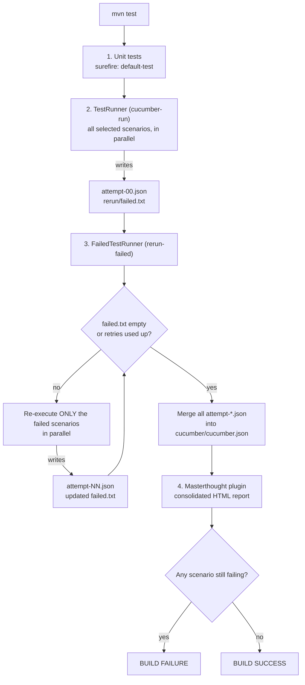

# Automation Test Framework

A Java 17 test automation framework for **REST API** and **browser UI** testing.
Scenarios are written in Gherkin (Cucumber), executed **in parallel** on the JUnit
Platform through Maven, **retried automatically** when they fail, and published as
**one consolidated Masterthought report** with API call logs and UI screenshots
attached.

## Table of contents

1. [Feature overview](#1-feature-overview)
2. [Technology stack](#2-technology-stack)
3. [How the framework works](#3-how-the-framework-works)
4. [Project layout](#4-project-layout)
5. [Configuration](#5-configuration)
6. [Writing tests](#6-writing-tests)
7. [Feature deep dive](#7-feature-deep-dive)
8. [Reporting](#8-reporting)
9. [Running tests locally](#9-running-tests-locally)
10. [Running tests in GitHub Actions](#10-running-tests-in-github-actions)
11. [Credentials and secrets](#11-credentials-and-secrets)
12. [Troubleshooting](#12-troubleshooting)

---

## 1. Feature overview

| Feature | What it gives you | Where to look |
| --- | --- | --- |
| **BDD scenarios** | Readable Gherkin feature files for API and UI tests, filtered by tags | `src/test/resources/features/` |
| **API testing** | Rest Assured requests, JSON payload templates, typed models | `PlaceApiSupport`, `Payload/`, `model/` |
| **UI testing** | Selenium WebDriver with the Page Object pattern; Chrome, Edge, Safari; headless mode | `pages/`, `BrowserFactory` |
| **Multi-environment config** | `dev` / `pre` / `prod` profiles, URL and secret overrides through environment variables | `src/*.properties`, `application-*.yml` |
| **Spring wiring** | Shared helpers injected into step classes; validated, typed configuration | `ApiProperties`, `CucumberSpringConfiguration` |
| **API request/response logging** | Method, URL, headers and body of every request and response in the console and in the report; secrets masked | `ApiLoggingFilter` |
| **UI screenshots** | Taken on step failure, assertion failure, scenario failure and at the end of every scenario; attached to the report | `Hooks`, `ScreenshotService`, `UiAssertions` |
| **Parallel execution** | Scenarios run concurrently (default 4 threads) | `junit-platform.properties`, `pom.xml` |
| **Failed-scenario rerun** | `FailedTestRunner` re-executes only the scenarios that failed, up to 4 times (default 3) | `FailedTestRunner`, `reporting/` |
| **Consolidated report** | One Masterthought HTML report with the final result of every scenario after all retries | `target/cucumber-html-reports/` |
| **GitHub Actions workflow** | Manual run with browser, environment, tags, retry count and threads; console logs, job summary and report artifacts | `.github/workflows/tests.yml` |

---

## 2. Technology stack

| Concern | Technology |
| --- | --- |
| Language / build | Java 17, Maven (Spring Boot parent `3.3.5` for dependency management) |
| BDD | Cucumber JVM `7.18.1` (`cucumber-java`, `cucumber-spring`) |
| Test engine | JUnit Platform: `cucumber-junit-platform-engine`, `junit-platform-suite`, `junit-platform-launcher`; JUnit 5 + Mockito for unit tests |
| Dependency injection / config | Spring Boot (`@SpringBootTest`, `@ConfigurationProperties`) |
| API | Rest Assured `5.5.0`, Jackson |
| UI | Selenium `4.52.0` (Selenium Manager downloads drivers) |
| Reports | `maven-cucumber-reporting` (Masterthought) `5.10.2`, Cucumber HTML, Extent Spark (`extentreports-cucumber7-adapter`) |
| Logging | SLF4J / Logback (Spring Boot default) |

Requirements: **Java 17**, **Maven 3.6.3+**, a browser for UI tests (Chrome, Edge
or Safari) and network access to the configured API and UI endpoints. Safari needs
macOS with *Allow Remote Automation* enabled and does not support headless mode or
parallel sessions.

---

## 3. How the framework works

### 3.1 Big picture



The Maven `test` phase runs these steps in order:

| Order | Maven plugin / execution | What it does |
| --- | --- | --- |
| 0 | `maven-clean-plugin` / `reset-test-results` (phase `process-test-classes`) | Deletes `target/cucumber`, `target/rerun`, `target/screenshots` and `target/cucumber-html-reports` so old results are never merged into the new report |
| 1 | `maven-surefire-plugin` / `default-test` | Runs plain unit tests (everything except the two runners). A failure stops the build before any Cucumber run |
| 2 | `maven-surefire-plugin` / `cucumber-run` | Runs `TestRunner`: the first, full, parallel execution of the selected scenarios. `testFailureIgnore=true` so failures do not stop the pipeline |
| 3 | `maven-surefire-plugin` / `rerun-failed` | Runs `FailedTestRunner`: retries failed scenarios and writes the merged `cucumber.json`. `testFailureIgnore=true` |
| 4 | `maven-cucumber-reporting` / `cucumber-report` | Generates the consolidated HTML report from `target/cucumber/cucumber.json`, then **fails the build if any scenario failed** |

Because the report is generated *after* the retries, it shows each scenario once with
its **final** outcome. The build result also reflects the final outcome: a scenario
that failed first but passed on a retry does not fail the build.

### 3.2 Life of a scenario

1. **Discovery.** `TestRunner` (a JUnit Platform `@Suite`) selects the `features`
   classpath folder, glue package `org.test.steps` and the tag expression in
   `cucumber.filter.tags`. The Cucumber engine turns every scenario (and every row of
   a Scenario Outline) into a test and schedules them on a fixed-size thread pool.
2. **Spring context.** `CucumberSpringConfiguration` boots `AutomationApplication`
   once per JVM. Configuration, `PlaceApiSupport`, `EnvironmentUrlResolver` and
   `ShoppingAppCredentials` are Spring beans shared by all scenarios.
3. **`@Before` hook.** `Hooks.startScenario` creates a `ScenarioContext` bound to the
   executing thread. It holds the running Cucumber `Scenario` and, for UI tests, the
   `WebDriver`.
4. **Steps.** Cucumber creates a fresh instance of each step class per scenario and
   injects Spring beans through the constructor. Steps call the support classes (API)
   or page objects (UI).
   - API calls go through `PlaceApiSupport.request()`, which installs
     `ApiLoggingFilter`; each call is logged and attached to the scenario.
   - UI steps register the browser with `ScenarioContext` so hooks can take
     screenshots.
5. **`@AfterStep` hook.** `Hooks.afterStep` captures a screenshot for the first step
   that fails the scenario.
6. **`@After` hook.** Scenario-specific cleanup (for example deleting created places)
   runs first. Then `Hooks.endScenario` (`order = 0`, runs last) takes the end-of-scenario
   screenshot, quits the browser and clears the thread's `ScenarioContext`.
7. **Reporting events.** Cucumber's plugins write the JSON report, the rerun file,
   the Cucumber HTML report and the Extent report. Attachments (screenshots and API
   logs) are embedded in the JSON.

### 3.3 Why the design is parallel-safe

- Each scenario runs start to finish on **one thread**, so per-scenario state lives in
  the thread-bound `ScenarioContext` (not in static fields).
- Step classes are created per scenario; Spring beans are stateless singletons.
- Each UI scenario creates and quits **its own browser**.
- Each log entry is written as **one atomic message** prefixed with the scenario name, so
  concurrent API logs do not interleave mid-call.
- Rule for new code: never keep scenario data in `static` mutable fields; keep it in
  step-class fields or `ScenarioContext`.

### 3.4 Request flow in the API tests

```text
Feature file -> Step definition -> PlaceApiSupport.request()
   (given().baseUri(...).contentType(JSON).filter(ApiLoggingFilter))
        -> HTTP call -> ApiLoggingFilter logs + attaches request/response
        -> response assertions (Rest Assured / Hamcrest / JUnit)
```

`ApiProperties` (bound to the `api.*` properties) provides the base URL, API key and
endpoint paths. It validates at startup that every value is set for the selected
environment and fails fast with a clear message if not.

---

## 4. Project layout

```text
.
├── pom.xml                              # Dependencies, surefire executions, clean + report plugins, threads
├── .github/workflows/tests.yml          # Manual GitHub Actions workflow
└── src/
    ├── bootstrap.properties             # Default environment and browser
    ├── environment.properties           # API and UI base URLs per environment
    ├── extent.properties                # Extent report output + screenshot locations
    ├── main/
    │   ├── java/org/test/
    │   │   ├── AutomationApplication.java       # Spring Boot application used by the tests
    │   │   └── config/ApiProperties.java        # Typed, validated api.* settings
    │   └── resources/
    │       ├── application.yml                  # Shared settings: endpoints, default address
    │       └── application-{dev,pre,prod}.yml   # Per-environment API URL and key
    └── test/
        ├── java/org/test/
        │   ├── TestRunner.java                  # Parallel Cucumber suite (first run)
        │   ├── FailedTestRunner.java            # Retry loop + merge of all attempts
        │   ├── reporting/
        │   │   ├── RetryPolicy.java             # -Dretry.count: default 3, max 4
        │   │   ├── RerunFile.java               # Reads Cucumber's rerun file
        │   │   ├── FailedScenarioExecutor.java  # Launches only the failed scenarios
        │   │   └── CucumberJsonMerger.java      # Merges attempt JSON files
        │   ├── steps/
        │   │   ├── CucumberSpringConfiguration.java
        │   │   ├── Hooks.java                   # @Before / @AfterStep / @After
        │   │   ├── AddPlaceSteps.java, PlaceOperationsSteps.java   # API steps
        │   │   └── ShopLoginSteps.java                              # UI steps
        │   ├── pages/                           # Selenium page objects
        │   ├── model/                           # API POJOs (Place, Location)
        │   └── support/
        │       ├── PlaceApiSupport.java         # Rest Assured request builder
        │       ├── ApiLoggingFilter.java        # Request/response logging
        │       ├── BrowserFactory.java          # Chrome / Edge / Safari creation
        │       ├── EnvironmentUrlResolver.java  # Resolves <env>.<service>.url
        │       ├── ShoppingAppCredentials.java  # Resolves UI credentials
        │       ├── ScenarioContext.java         # Thread-bound scenario + driver
        │       ├── ScreenshotService.java       # Capture, save, attach
        │       ├── ScenarioScreenshots.java     # When to capture
        │       └── UiAssertions.java            # Assertions that screenshot on failure
        └── resources/
            ├── junit-platform.properties        # Parallelism + default tags
            ├── features/                        # Gherkin feature files
            ├── Payload/                         # JSON request templates
            └── LoginData/                       # Local UI credentials (git-ignored)
```

Build output goes to `target/` (git-ignored); see [Reporting](#8-reporting).

---

## 5. Configuration

### 5.1 Configuration layers

| File | Purpose | Notes |
| --- | --- | --- |
| `src/bootstrap.properties` | Default `environment` (`dev`) and `browser` (`edge`) | Copied to `target/classes` and imported by `application.yml` |
| `src/environment.properties` | `<env>.api.url` and `<env>.ui.url` for `dev`, `pre`, `prod` | `pre` and `prod` are blank until you set them |
| `src/main/resources/application.yml` | Shared API endpoint paths, default update address, default Spring profile (`${environment:dev}`) | |
| `src/main/resources/application-<env>.yml` | `api.base-url` and `api.key` for the selected profile | `dev` has a test-service key default; `pre`/`prod` require `API_KEY` |
| `src/test/resources/junit-platform.properties` | Parallel settings and default `cucumber.filter.tags` | See below |
| `src/extent.properties` | Extent Spark report path and screenshot folder | |
| `src/test/resources/LoginData/ShoppingApp.properties` | Local UI credentials | Git-ignored; optional |
| `pom.xml` | `threads` property, surefire executions, clean and report plugins | |

How an environment is chosen: the Spring profile is `-Dspring.profiles.active=<env>` if
given, otherwise the `environment` value from `bootstrap.properties` (`dev`). That
profile loads `application-<env>.yml` and decides which `<env>.api.url` /
`<env>.ui.url` entries are used.

### 5.2 Everything you can set

Pass system properties with `-D` on the Maven command line, or environment variables.

| Setting | How | Default | Effect |
| --- | --- | --- | --- |
| Environment | `-Dspring.profiles.active=dev\|pre\|prod` | `dev` | Selects profile, URLs, key and credential suffix |
| Browser | `-Dbrowser=chrome\|edge\|safari` | `edge` | Browser for UI scenarios |
| Headless | `-Dbrowser.headless=true` | `false` | Headless Chrome/Edge (not Safari) |
| Tags | `-Dcucumber.filter.tags="<expr>"` | `@uiSanity` | Cucumber tag expression selecting scenarios |
| Threads | `-Dthreads=N` | `4` | Scenarios executed in parallel (`1` = sequential) |
| Retries | `-Dretry.count=N` | `3` | Times failed scenarios are re-run; capped at `4`; `0` disables |
| Skip report | `-Dcucumber.skip=true` | off | Skips the Masterthought goal (useful for unit-only runs) |
| API URL | env `API_BASE_URL` | from `environment.properties` | Overrides the API base URL |
| API key | env `API_KEY` | `qaclick123` on `dev` only | Overrides / supplies the API key |
| UI URL | env `UI_BASE_URL` | from `environment.properties` | Overrides the UI URL |
| UI credentials | env `SHOP_EMAIL`, `SHOP_PASSWORD` | file values | Override `LoginData/ShoppingApp.properties` |

Precedence: command-line system properties and environment variables win over the
property and YAML files.

### 5.3 Parallelism settings

`src/test/resources/junit-platform.properties`:

```properties
cucumber.execution.parallel.enabled=true
cucumber.execution.parallel.config.strategy=fixed
cucumber.execution.parallel.config.fixed.parallelism=4
cucumber.execution.parallel.config.fixed.max-pool-size=4
cucumber.filter.tags=@uiSanity
```

`pom.xml` defines `<threads>4</threads>` and forwards it to surefire as
`cucumber.execution.parallel.config.fixed.parallelism` and `...max-pool-size`, so
`-Dthreads=N` overrides the pool size without editing files.

### 5.4 Adding a new environment

1. Add `<env>.api.url` and `<env>.ui.url` to `src/environment.properties`.
2. Add `src/main/resources/application-<env>.yml` with `api.base-url: ${API_BASE_URL:${<env>.api.url:}}` and `api.key: ${API_KEY:}`.
3. Add `email_<env>` / `password_<env>` to `LoginData/ShoppingApp.properties` (or set `SHOP_EMAIL` / `SHOP_PASSWORD`).
4. Run with `-Dspring.profiles.active=<env>` and add `<env>` to the workflow's environment options.

### 5.5 Browsers

`BrowserFactory` creates Chrome, Edge or Safari. Chrome and Edge use a 1440x1000 window and
`--headless=new` when headless is requested. Selenium Manager downloads matching
drivers automatically. A stale driver on your `PATH` can shadow it; see
[Troubleshooting](#12-troubleshooting).

---

## 6. Writing tests

### 6.1 Feature files

Add `.feature` files under `src/test/resources/features/`. Tags drive selection:

| Tag | Meaning |
| --- | --- |
| `@Regression` | Whole regression pack (API + UI) |
| `@Sanity`, `@apiSanity` | Positive API CRUD checks |
| `@uiSanity`, `@healthcheck` | UI login smoke test / health check scenarios |
| `@apiRegression`, `@ui`, `@login` | Feature-level groupings |
| `@positive`, `@negative`, `@edge` | Scenario type |
| `@get`, `@put`, `@delete` | Scenarios that create data needing cleanup (used by `@After` hooks) |

Tag expressions: `@apiSanity or @uiSanity`, `@Regression and not @negative`.

### 6.2 Step definitions

Put glue classes under `src/test/java/org/test/steps/` (the glue package is
`org.test.steps`). Inject Spring beans through the constructor:

```java
public class MySteps {
    private final PlaceApiSupport api;
    private final ApiProperties properties;

    public MySteps(PlaceApiSupport api, ApiProperties properties) {
        this.api = api;
        this.properties = properties;
    }
}
```

### 6.3 API tests

- Build requests with `api.request()` (adds base URI, JSON headers and the logging
  filter), then `api.withKey(...)` / `api.withPlaceId(...)` for query parameters.
- Keep JSON templates in `src/test/resources/Payload/` (for example `AddPlace.json`) and
  load them through `PlaceApiSupport`; Jackson maps them to the `Place` model, and
  Examples tables supply the variable values. Separate multiple types with `;`.
- Never put credentials or API keys in payloads or Examples.
- Tests that create data should clean it up in an `@After` hook (see
  `PlaceOperationsSteps.cleanUpCreatedPlace`).

### 6.4 UI tests

- Put selectors and page actions in `src/test/java/org/test/pages/` page objects
  (`@FindBy` + `PageFactory`).
- Create the browser with `BrowserFactory.create(...)` and **register it** so screenshots
  work:

  ```java
  driver = BrowserFactory.create(browserName, headless);
  ScenarioContext.current().ifPresent(context -> context.driver(driver));
  ```

- Do **not** quit the browser in your steps; `Hooks.endScenario` takes the final screenshot
  and quits it.
- Use `UiAssertions` for assertions so a failure is captured before the page changes:

  ```java
  UiAssertions.assertTrue("Shop dashboard is displayed", dashboard.isDisplayed());
  UiAssertions.assertEquals("Cart count", 2, cart.count());
  UiAssertions.verify("Custom check", () -> assertThat(...));
  ```

---

## 7. Feature deep dive

### 7.1 API request/response logging

`ApiLoggingFilter` is a Rest Assured `Filter` added to every request built through
`PlaceApiSupport.request()`. For each call it produces one block:

```text
API call [scenario: Add a place with valid details]
>>> REQUEST
POST https://host/maps/api/place/add/json?key=****
Headers:
  Content-Type: application/json
Body:
{ ...pretty-printed JSON... }
<<< RESPONSE HTTP/1.1 200 OK (1128 ms)
Headers:
  Content-Type: application/json;charset=UTF-8
Body:
{ ...pretty-printed JSON... }
```

- **Console / GitHub log:** written through SLF4J at INFO, one message per call, prefixed
  with the scenario name so parallel output stays readable.
- **Reports:** the same text is attached to the scenario as `text/plain`, so it shows in
  the Masterthought report next to the step.
- **Masking:** `Authorization`, `Proxy-Authorization`, `Cookie`, `Set-Cookie`,
  `X-Api-Key` header values and the `key`, `api_key`, `apikey`, `access_token`, `token`,
  `password` query parameters are replaced with `****`.
- If a request throws before a response arrives, the request is logged with
  `<<< NO RESPONSE: <error>`.

### 7.2 UI screenshots

Screenshots are saved as PNGs in `target/screenshots/` and attached to the scenario
(image embeddings in the report). They are taken:

| When | Title in the report | Implemented by |
| --- | --- | --- |
| A step fails (exception, timeout, element not found) | `Step failed` (attached to that step) | `@AfterStep` in `Hooks` via `ScenarioScreenshots.afterStep` |
| An assertion made with `UiAssertions` fails | `Assertion failed - <message>` (taken before the error is thrown) | `UiAssertions.verify` |
| The scenario fails | `Scenario failed (FAILED)` | `@After` in `Hooks` |
| Every scenario ends (passed or failed) | `End of scenario (PASSED)` or `Scenario failed (FAILED)` | `@After` in `Hooks` |

De-duplication: when an assertion already captured the failing moment, the failing step
does not add a second screenshot, and later skipped steps never add more. Screenshot
problems (browser already closed, driver without screenshot support) are logged as
warnings and never change the test result. API-only scenarios have no browser and take
no screenshots.

### 7.3 Parallel execution

Parallelism uses the Cucumber JUnit Platform engine (no extra Maven forks), so every
scenario is a unit of work. Use `-Dthreads=N` to change the number of concurrent
scenarios. Console output of parallel scenarios is interleaved; filter by the thread name
(`Pool-N-worker-M`) or scenario name in the log. Safari supports one session at a time,
so use `-Dthreads=1` (the workflow does this automatically).

### 7.4 Failed-scenario rerun and retries

**Classes**

| Class | Role |
| --- | --- |
| `TestRunner` | First run. Its `rerun` plugin writes failed scenario locations to `target/rerun/failed.txt` (for example `classpath:features/AddPlace.feature:33:44`) |
| `FailedTestRunner` | Retry loop and merge. Reads `failed.txt`, re-executes only those scenarios, repeats |
| `RetryPolicy` | Resolves `-Dretry.count`: default `3`, maximum `4`, negative becomes `0`, non-numeric values are rejected |
| `RerunFile` | Parses `failed.txt` into feature + scenario line numbers |
| `FailedScenarioExecutor` | Starts the JUnit Platform launcher with one selector per failed scenario line, same glue and parallel settings |
| `CucumberJsonMerger` | Merges all `attempt-NN.json` files |

**Algorithm** (`FailedTestRunner.rerunFailedScenarios`)

```text
retries = resolve(-Dretry.count)            // 0..4, default 3
repeat up to `retries` times:
    failed = scenarios listed in target/rerun/failed.txt
    if failed is empty -> stop
    run only `failed` in parallel
        -> target/cucumber/attempts/attempt-NN.json
        -> new failed list replaces target/rerun/failed.txt
merge attempt-00 ... attempt-NN into target/cucumber/cucumber.json
fail the test if failed.txt is still not empty
```

Example: 100 scenarios run, 60 pass, 40 fail. Retry 1 re-runs those 40; 20 pass, 20
still fail. Retry 2 re-runs only those 20, and so on until nothing fails or the
retries (maximum 4) are used up. Total executions of a scenario: 1 + retries.

Attempt files are numbered from the highest existing number, so running
`FailedTestRunner` again later keeps older results and the newest result always wins in
the merge.

Run it on its own after an earlier `mvn test`:

```sh
mvn test-compile surefire:test@rerun-failed -Dretry.count=2
mvn net.masterthought:maven-cucumber-reporting:5.10.2:generate@cucumber-report
```

(The first command exits successfully even if scenarios still fail because the execution
uses `testFailureIgnore`; the second command is the one that reports the final
result.)

### 7.5 Consolidation of results

`CucumberJsonMerger` reads `attempt-00.json` (first run), `attempt-01.json`, ... in order.
Scenarios are identified by feature URI + scenario id (Scenario Outline example rows
have unique ids). A scenario that was re-executed is **replaced in place** by its latest
result, together with its Background block; scenarios that were not re-executed keep
their first-run result. The output is a single `cucumber.json` containing each scenario
exactly once.

---

## 8. Reporting

### 8.1 What is generated

| Path (under `target/`) | Content | Scope |
| --- | --- | --- |
| `cucumber-html-reports/overview-features.html` | **Consolidated Masterthought report**: features, scenarios, steps, tags, failures, API logs, screenshots | All attempts, final results |
| `cucumber/cucumber.json` | Consolidated Cucumber JSON, input of the Masterthought report | All attempts, final results |
| `cucumber/attempts/attempt-NN.json` | Raw JSON per run (`00` = first run, `01+` = retries) | Single attempt |
| `rerun/failed.txt` | Scenarios still failing after the last attempt | Final state |
| `rerun/attempt-NN.txt` | Scenarios that failed in a given retry | Single retry |
| `screenshots/*.png` | Saved screenshots | All attempts |
| `cucumber-report.html` | Cucumber's native HTML report | **First run only** |
| `extent/extent-report.html`, `extent/screenshots/` | Extent Spark report and its images | **First run only** |
| `surefire-reports/` | JUnit/surefire results (unit tests and runners) | Per execution |

The **single consolidated report is the Masterthought report**. The Cucumber HTML and
Extent reports describe the first run only, before retries, and are not consolidated.

### 8.2 Reading the Masterthought report

Open `target/cucumber-html-reports/overview-features.html`:

- **Features / Tags / Steps / Failures** tabs give overviews and failure lists.
- A feature page shows each scenario with its steps. Attachments appear under the step
  that produced them: **API call** text blocks (request and response) and screenshots
  (`Step failed`, `Assertion failed - ...`, `Scenario failed`, `End of scenario`).
- Each scenario appears **once** with its final result. A scenario that failed and later
  passed is shown as passed.

### 8.3 Build result

The Masterthought goal fails the build with `BUILD FAILED - Check Report For Details`
after generating the report when any scenario in the consolidated results is still
failing. Exit codes therefore mean:

| Outcome | Build |
| --- | --- |
| All scenarios pass in the first run | success |
| Some fail, all pass within the retries | success |
| Some still fail after the last retry | **failure** (report is still generated) |
| A unit test fails | failure before any Cucumber run |

### 8.4 Console and CI output

The console shows Cucumber's summary for each attempt, `START`/`FINISH` lines per
scenario, every API call, screenshot file names, and banners such as
`===== Retry 1 of 3: re-executing 16 failed scenario(s) =====` and
`===== Consolidated 4 run result(s) into target/cucumber/cucumber.json =====`.

---

## 9. Running tests locally

Run from the repository root. Prefer `mvn clean test` after switching branches or when
Maven reports stale classes.

```sh
# Default tag (@uiSanity)
mvn test

# Specific tags
mvn clean test -Dcucumber.filter.tags="@healthcheck"
mvn clean test -Dcucumber.filter.tags="@Sanity"
mvn clean test -Dcucumber.filter.tags="@Regression"
mvn clean test -Dcucumber.filter.tags="@apiSanity or @uiSanity"

# UI scenario in Chrome, headless
mvn clean test -Dcucumber.filter.tags="@login" -Dbrowser=chrome -Dbrowser.headless=true

# Another environment
API_KEY='your-key' mvn clean test -Dspring.profiles.active=pre

# Parallelism and retries
mvn clean test -Dcucumber.filter.tags="@Regression" -Dthreads=2 -Dretry.count=4
mvn clean test -Dthreads=1 -Dretry.count=0       # sequential, no retries

# Unit tests only
mvn test -Dtest='RetryPolicyTest,CucumberJsonMergerTest' -Dcucumber.skip=true
```

These are integration tests: API scenarios call real HTTP services, and the
Add/Get/Update/Delete scenarios create and modify data and attempt cleanup. Use a test
environment and only run against systems you are authorized to test; do not point
destructive scenarios at production without explicit approval.

---

## 10. Running tests in GitHub Actions

The manual workflow `.github/workflows/tests.yml` appears under **Actions > Automation
tests > Run workflow** once it is on the default branch. Use **Use workflow from** to
pick the branch to test.

### Inputs

| Input | Default | Purpose |
| --- | --- | --- |
| `browser` | `chrome` | `chrome`, `edge` or `safari`. Chrome/Edge run headless on Ubuntu; Safari runs on macOS |
| `environment` | `dev` | `dev`, `pre`, `prod`: Spring profile and GitHub Environment |
| `tags` | `@uiSanity` | Cucumber tag expression |
| `retry_count` | `3` | Retries of failed scenarios (maximum 4) |
| `threads` | `4` | Parallel scenarios (Safari always uses 1) |

### What the job does

1. Checks out the selected branch and sets up Java 17 with Maven caching.
2. Runs `mvn clean test` with the inputs mapped to `-Dspring.profiles.active`,
   `-Dbrowser`, `-Dbrowser.headless`, `-Dcucumber.filter.tags`, `-Dretry.count` and
   `-Dthreads`. Empty secrets are unset so the configured defaults apply.
3. **Console log:** every API request/response, scenario start/finish lines, retry banners
   and screenshot paths are visible in the job log.
4. **Job summary:** a *Consolidated Cucumber results* section lists passed/failed counts and
   the names of scenarios that still fail after retries.
5. **Artifact** `reports-<environment>-<browser>` (uploaded even when tests fail):
   `target/cucumber-report.html`, `target/cucumber/`, `target/rerun/`,
   `target/cucumber-html-reports/`, `target/extent/` and `target/screenshots/`.
   Download it and open `cucumber-html-reports/overview-features.html` for the
   consolidated report.

### Secrets

Add them as repository secrets (**Settings > Secrets and variables > Actions**) or as
GitHub Environment secrets for `dev`, `pre`, `prod`; an environment secret overrides a
repository secret of the same name.

| Secret | Needed for |
| --- | --- |
| `SHOP_EMAIL` | UI login scenarios |
| `SHOP_PASSWORD` | UI login scenarios |
| `API_BASE_URL` | API tests when the profile has no configured URL |
| `API_KEY` | API tests when the profile has no configured key (`pre`, `prod`) |
| `UI_BASE_URL` | UI tests when the profile has no configured UI URL |

For `pre` and `prod`, configure the API URL and key (and UI URL and shop credentials for
UI runs) first; their checked-in URLs are blank. If the shop credentials are missing,
the login step fails before a browser opens, so no screenshot is possible for that
failure.

---

## 11. Credentials and secrets

**UI credentials** are resolved by `ShoppingAppCredentials`:

1. environment variables `SHOP_EMAIL` / `SHOP_PASSWORD`, otherwise
2. `email_<env>` / `password_<env>` in `src/test/resources/LoginData/ShoppingApp.properties`
   (git-ignored; `<env>` is the active profile).

```properties
email_dev=your-dev-account-email
password_dev=your-dev-password
```

```sh
export SHOP_EMAIL='your-account-email'
read -rs SHOP_PASSWORD && export SHOP_PASSWORD
mvn clean test -Dcucumber.filter.tags="@login"
```

**API key** comes from `api.key` of the active profile (`API_KEY` overrides it); only
`dev` has a built-in test-service default.

Never commit credentials. API logs mask common secret headers and query parameters, but
request and response *bodies* are logged as sent, so do not place secrets in payloads.

---

## 12. Troubleshooting

| Symptom | Cause / fix |
| --- | --- |
| `This version of ChromeDriver only supports Chrome version N` | An old `chromedriver` on `PATH` shadows Selenium Manager. Remove/update it, or use `-Dbrowser=edge` |
| `Configure API_BASE_URL or <env>.api.url ...` / `api.key must be configured` | The selected profile has no URL/key. Set `environment.properties` values or `API_BASE_URL` / `API_KEY` |
| `Set SHOP_EMAIL or email_<env> in LoginData/ShoppingApp.properties` | UI credentials are missing for the active profile |
| `basedir .../target/cucumber does not exist` from the report plugin | No Cucumber results were produced (for example a `-Dtest=` filter). Add `-Dcucumber.skip=true` or run the full build |
| `No tests were executed` with `-Dtest=...` | Add `-Dsurefire.failIfNoSpecifiedTests=false` |
| Build fails although retries ran | Scenarios are still failing after the last retry; open the consolidated report, or see `target/rerun/failed.txt` |
| Negative API scenarios keep failing with "expected 4xx but got 200" | The service accepted the input; these are real application results, retries cannot fix them |
| Stale classes / `Nothing to compile` errors | Run `mvn clean test` |
| Safari fails with parallel runs | Safari allows one session; use `-Dthreads=1` |
| Interleaved console output | Expected in parallel runs; filter by scenario name or `Pool-N-worker-M` |
| Extent report lacks retries | By design: Extent describes the first run only; use the Masterthought report |
